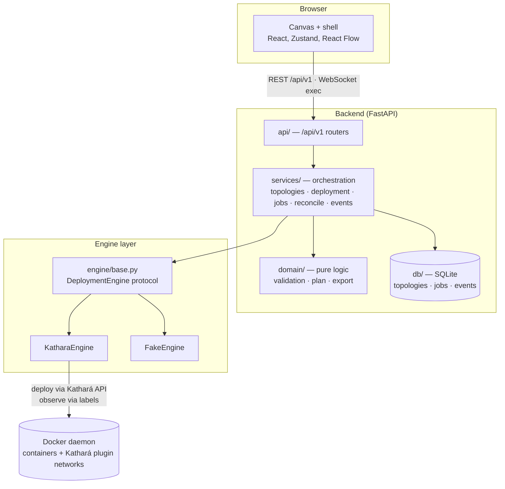
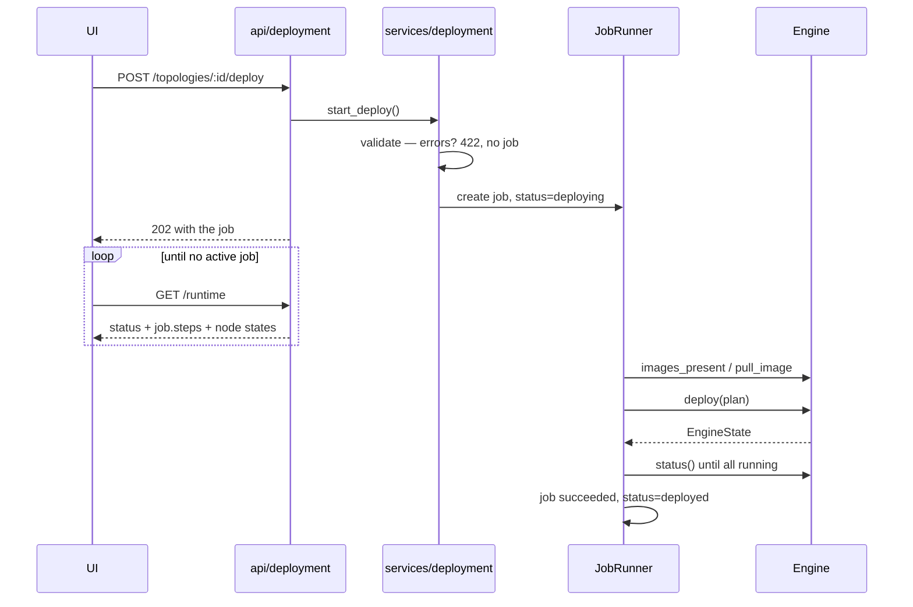

# AE3GIS Architecture Guide

**Audience:** developers working on AE3GIS. Read this once before your first
change; it explains the shape of the system and the handful of ideas everything
else follows from.

For the short version, see the root [`README.md`](../README.md). For the rules
Claude Code follows when editing this repo, see [`CLAUDE.md`](../CLAUDE.md).

---

## 1. What AE3GIS is

AE3GIS is a **network topology editor that deploys what you draw**. You design a
multi-site ICS/IT network in a browser canvas, and the backend turns that design
into real Linux containers wired together with real IP addressing and routing,
so you can open a shell on a device and ping across subnets.

Three tiers:

| Tier | Job |
|---|---|
| **Frontend** | Draw and edit the topology. Visualise state. Never decides how anything deploys. |
| **Backend** | Store the design, validate it, compute the lab plan, run deployments as jobs, track runtime state. |
| **Engine** | Instantiate a lab plan as containers. Kathará today, swappable. |

The guiding principle: **the backend is the source of truth for everything
derived**. The frontend owns the design document and how it looks; the backend
owns what that document *means* — whether it is valid, what it would deploy,
what is running right now.

---

## 2. Quickstart

### Run it

```bash
./start.sh              # docker compose up --build
```

- Editor: <http://localhost:3000>
- API docs: <http://localhost:8000/api/v1/docs>

By default there is no sign-in: the API is open and every caller is the
instructor, which suits a local lab and **not** a shared host, since the API
creates and destroys containers. For a class, turn accounts on (§5.10):

```bash
AE3GIS_INSTRUCTOR_PASSWORD=choose-one ./start.sh
```

### A ten-minute tour

1. Open the editor. Under **Presets**, click **Use preset** on *Two-Subnet
   Demo*. You land in the canvas at the deepest useful level.
2. Walk the drill-down with the breadcrumb: **Network → Site → Subnet**. Select
   a subnet and press <kbd>E</kbd> to expand it in place instead of drilling in.
3. Click **Deploy**. Watch the status pill move through the job's steps
   (`validate → images → plan → deploy → verify`). The first deploy pulls
   images, so it takes a minute.
4. When node dots turn green, double-click a device to open a terminal, then
   `ping` a host in the other subnet. Routing was generated for you.
5. Select any device and open **Deployment plan** in the inspector: machine
   name, image, interfaces, and the exact boot commands the engine ran.
6. Click **Destroy**, then open **Labs on this host** in the library to confirm
   nothing was left behind.

### Develop without Docker

The backend ships an in-memory engine, so you can run the whole stack with no
containers at all:

```bash
cd backend && AE3GIS_ENGINE=fake python -m uvicorn main:create_app --factory --port 8000
cd frontend && npm run dev     # :5173, proxies /api to :8000
```

Deploys succeed instantly and every node reports running. Terminals will not
work (there is no container to attach to), but every other flow does.

### The commands you will actually use

```bash
# Frontend (cd frontend)
npm run dev          # vite dev server, :5173
npm run build        # typecheck + production bundle
npm run test         # vitest
npm run lint         # eslint
npm run api:types    # regenerate src/api/schema.d.ts from backend/openapi.json

# Backend (cd backend)
python -m pytest                          # full suite, ~1s, no Docker needed
ruff check . && ruff format --check .     # both are CI gates
python scripts/export_openapi.py          # regenerate openapi.json after API changes
python -m uvicorn main:create_app --factory --reload --port 8000
```

---

## 3. The big picture



Two things to notice:

- **Routers are thin.** `api/` validates input shapes and calls a service.
  Orchestration lives in `services/`, decisions live in `domain/`.
- **Nothing imports an engine directly.** Services receive one through
  `app.state`, which is why the whole test suite runs in about a second against
  `FakeEngine` with no Docker.

---

## 4. The three contracts

Almost every design question in this codebase is answered by one of these.

### 4.1 The topology document is opaque JSON

The backend stores `Topology.data` **exactly as the frontend sends it** and
never reshapes or strips it. `api/schemas.py` types only the envelope
(`TopologyCreate`, `TopologyRecord`, …), each with `data: dict`.

The frontend owns the document's shape in
[`frontend/src/types/topology.ts`](../frontend/src/types/topology.ts), where
every entity carries an index signature so unknown fields round-trip untouched.
Either side can add a field without the other changing.

```
sites[] → subnets[] → containers[]
        ↘ subnetConnections[]     ↘ connections[]
siteConnections[]
```

So what stops garbage reaching the engine? Not a schema — **diagnostics**
(§4.2). A draft is allowed to be incomplete; a deploy is not.

> Proven by `backend/tests/test_api_v1.py::test_unknown_fields_round_trip`.

### 4.2 Diagnostics, not schema rejection

[`domain/validation.py`](../backend/domain/validation.py) returns a list of
`Diagnostic { code, severity, message, path, node_id }`.

| Severity | Meaning | Effect |
|---|---|---|
| `error` | The engine cannot work around it | Deploy refused (422 `validation_failed`) |
| `warning` | The engine will guess, or ignore the field | Shown, deploy allowed |

Saving **never** fails validation. The frontend shows diagnostics in the
inspector's *Issues* section and disables Deploy while errors exist; the backend
enforces the same rule server-side, so an API client cannot skip it.

Examples of each: a duplicate IP inside a subnet or a subnet with inter-subnet
links but no router are errors; an unknown node type (deploys as a plain host)
or `persistencePaths` (stored, not applied by the Kathará engine) are warnings.

### 4.3 The node catalog is data

[`backend/catalog/node_types.json`](../backend/catalog/node_types.json) is the
single source of truth for node types, served at `GET /api/v1/catalog`. It is
validated at load by the pydantic models in `catalog/models.py`, and served with
that model, so the frontend's catalog types are generated from OpenAPI too.

```jsonc
"categories": [{ "id": "security", "label": "Security" }, …],     // palette order
"sources": { "ae3gis-containers": { "kind": "git", "url": "…", "ref": "main" } },
"images": {
  "ae3gis.local/nftables": {
    "displayName": "nftables", "stability": "stable",            // | experimental | hidden
    "source": { "kind": "build", "repo": "ae3gis-containers", "context": "nftables", "dockerfile": "dockerfile" },
    "platforms": ["linux/amd64", "linux/arm64"]                  // optional
  },
  "postgres:alpine": { "displayName": "PostgreSQL (Alpine)",
    "env": { "POSTGRES_PASSWORD": "pass" } },                    // optional: every node's environment
  "ae3gis.local/open-vswitch": { "displayName": "Open vSwitch", …,
    "ownBridge": "br0" },                                        // optional: the image bridges its ports
  "httpd:alpine": { "displayName": "httpd (Alpine)",
    "shell": "/bin/sh" }                                         // optional: boot shell if the image has no bash
},
"types": {
  "firewall": {
    "displayName": "Firewall", "role": "router", "category": "security",
    "defaultImage": "kathara/frr",
    "images": ["kathara/frr", "ae3gis.local/iptables", "ae3gis.local/nftables", "ae3gis.local/firehol"],
    "color": "#ff3344", "label": "FW", "icon": "firewall", "purdueLevel": 3.5
  }
}
```

`role` (`router` | `switch` | `host`) drives how the engine configures the node.
A type's `images` are its **variants**: interchangeable images for the same job
(the palette nests them under the type, the inspector's Variant picker switches
between them). `images` at the top level describes image refs; a ref it does not
list is pulled from a registry as before, and one with a `build` source is built
by AE3GIS (§5.6). Unknown types degrade to `host` rather than blocking a deploy.
An image's `env` is set on every node that runs it (some entrypoints refuse to
start without a variable). `ownBridge` marks an image that builds a bridge over
all its ethN itself (Open vSwitch): as a switch it is only addressed (IP on that
bridge), never given AE3GIS's Linux bridge, which would race it for the ports.
`shell` names the shell boot commands run through where an image has no bash
(Kathará defaults to bash and silently skips a node's boot without it, leaving
it unaddressed).

**Adding a node type should be a one-line JSON edit.** It appears in the
palette, add menus, inspector type picker, and Purdue view automatically (they
all read one grouping, `frontend/src/catalog/tree.ts`). Only a genuinely new
glyph needs code, in `frontend/src/catalog/icons/classic.tsx`.

**The catalog in effect = the file + registries.** Images loaded from Docker
Hub namespaces (§5.6, "Docker Hub registries") are merged over the built-in
catalog (`catalog/registry.py`) and installed with
`catalog.set_registry_overlay`; every reader (`load_model`, `role_for`,
`image_shell`, the served `/catalog`…) then sees them. It is process-wide, like
the file cache, and rebuilt from the DB at startup. `builtin_model()` ignores
it: benchmark censuses use it, so their results do not depend on which
registries an instance added. Registry images carry `source.registry` and the
types they define `origin` (the namespace); `node_types.json` never changes.

### 4.4 (Bonus) The API contract is generated

`backend/openapi.json` is generated from the live app by
`backend/scripts/export_openapi.py`, and CI fails if it is stale. The frontend
generates its TypeScript types from that file (`npm run api:types` →
`src/api/schema.d.ts`), so the backend is the typed source of truth for the API.

**Change an endpoint → regenerate both.**

---

## 5. Backend

### 5.1 Layers

```
main.py           create_app(settings, engine) — the only entry point
  ├── config.py   Settings (pydantic-settings, AE3GIS_* env)
  ├── api/        thin routers under /api/v1, one error envelope
  ├── services/   orchestration; owns transactions and state transitions
  ├── domain/     pure functions; no DB, no engine, no FastAPI
  ├── engine/     the seam + implementations + terminal bridge
  └── db/         SQLAlchemy models + Alembic migrations
```

| Directory | Contains | Depends on |
|---|---|---|
| `api/` | `accounts` (/auth), `classroom` (/class), `access` (who may touch what), `topologies`, `deployment`, `jobs`, `images`, `captures`, `traffic`, `monitors`, `benchmarks`, `system`, `catalog`, `presets`, `deps`, `errors`, `schemas` | services, domain |
| `services/` | `accounts`, `topologies`, `deployment`, `jobs` (+ `joblogs`), `images`, `sources`, `reconcile`, `events`, `capture`, `traffic`, `monitor`, `netns_driver`, `benchmark` | domain, engine, db |
| `domain/` | `topology` (read helpers), `selectors`, `validation`, `plan`, `images` (fingerprints, statuses), `export/`, `monitor`, `telemetry`, `traffic/` (iperf3, patterns, summary), `generator`, `benchmark` | catalog only |
| `engine/` | `base` (protocol), `kathara/`, `fake` (+ `fake_helpers`), `docker_sidecar`, `docker_build`, `terminal` | domain |
| `db/` | `models`, `session`, `migrations/` | — |

`main.create_app` takes its settings and engine as arguments and does nothing at
import time. Uvicorn runs it with `--factory`; tests build their own app with a
temporary SQLite file and a `FakeEngine`.

### 5.2 The API surface

All under `/api/v1`. Errors share one envelope: `{"detail": ..., "code": ...}`
plus extras (`diagnostics`, `current_version`), so clients branch on `code`
rather than matching message text.

| Endpoint | Purpose |
|---|---|
| `POST /auth/login`, `/auth/signup`, `/auth/logout`, `GET /auth/me`, `POST /auth/password`, `/auth/webui-cookie` | Accounts (§5.10) |
| `GET/PUT /class`, `GET /class/students`, `POST /class/students/{id}/reset-password`, `DELETE /class/students/{id}` | The instructor's class: sign-up, join code, students (§5.10) |
| `GET/POST /topologies`, `GET/PUT/DELETE /topologies/{id}` | CRUD. `PUT` takes `version` for optimistic concurrency |
| `POST /topologies/{id}/copy`, `.../reset`, `PUT .../published` | A student's copy of a published topology (or a duplicate), reset it to its source, publish (§5.10) |
| `POST /topologies/import-json` | Import a design file |
| `POST /topologies/validate` | Validate a document without saving |
| `POST /topologies/{id}/validate` | Validate what is stored |
| `GET /topologies/{id}/plan` | The computed lab plan |
| `GET /topologies/{id}/export?format=` | `labspec` \| `kathara` \| `containerlab` |
| `POST /topologies/{id}/deploy`, `.../destroy` | 202 + a job |
| `GET /topologies/{id}/runtime` | Status + active job + node states, in one call |
| `GET /topologies/{id}/events`, `.../jobs`, `GET /jobs/{id}` | History |
| `GET /jobs/{id}/log?offset=`, `POST /jobs/{id}/cancel` | A job's log (by byte offset), cancellation |
| `GET /images?topology_id=` | Build support, image sources, and each image's status |
| `POST /images/builds`, `POST /sources/{name}/sync` | 202 + build jobs / a sync job |
| `GET/POST /registries`, `POST /registries/{id}/sync`, `DELETE /registries/{id}` | Docker Hub namespaces whose images join the catalog (§5.6) |
| `GET /topologies/{id}/context` | Record + diagnostics + plan + runtime + events |
| `GET /topologies/{id}/interfaces` | The deployed lab's interfaces and links (what captures can target) |
| `POST /jobs/{id}/stop`, `GET /jobs/{id}/artifacts[/{name}]` | Stop an open-ended job (keeps its output); the files a job produced |
| `POST/GET /topologies/{id}/captures`, `GET /captures/{id}` | Packet captures (§5.7) |
| `GET /captures/{id}/pcap?follow=`, `/captures/{id}/packets` | The pcap (live with `follow`), packet summaries |
| `POST/GET /topologies/{id}/traffic/runs`, `GET /traffic/runs/{id}[/samples\|/export]` | Traffic runs: flows and patterns (§5.7) |
| `POST/GET /topologies/{id}/monitors`, `GET /monitors/{id}[/samples\|/export]` | Monitors: CPU, memory, network of nodes and host (§5.7) |
| `POST /topologies/{id}/scenario/steps/run`, `…/scenario/phases/{phaseId}/run`, `GET /scenario/runs/{id}[/samples\|/export]` | Scenario runner: step through commands on nodes (§5.7) |
| `POST /topologies/generate` | A topology from a few numbers (the benchmarks' generator) |
| `POST/GET /benchmarks`, `GET /benchmarks/{id}[/report.md\|/export]` | Sweeps, climbs, image censuses, traffic matrices (§5.8) |
| `GET /system/health`, `/system/labs`, `/system/environment`, `POST /system/reconcile`, `/system/labs/{hash}/purge` | Operations |
| `WS /topologies/ws/{id}/exec/{container_id}` | Interactive shell |
| `WS /topologies/ws/{id}/captures/{job}`, `…/traffic/{job}`, `…/monitors/{job}`, `…/scenario/{job}` | Live packets / flow samples / monitor sweeps / scenario step output |
| `GET\|POST /topologies/{id}/webui/{node}/{path}` | Relay a node's own web UI to the browser (§5.9) |

`context` exists for clients that need the whole picture at once — a support
view, or the planned agent.

### 5.3 Jobs: how long operations work

Deploy used to run inside the HTTP request with no progress and no persisted
intermediate state. Now every long operation is a row in `jobs`.



- **Steps.** Deploy runs `validate → images → plan → deploy → verify`; destroy
  runs `stop → undeploy → verify` (`stop → save → undeploy → verify` with
  `?save=true`, §5.5a); an image build runs `source → snapshot → build →
  verify`. Each transition is written to the job row and mirrored into `events`.
- **Subjects.** A job serialises on its `subject`: `topology:<id>`,
  `image:<ref>`, `source:<name>`, `capture:<topology>:<node>:<interface>`,
  `traffic:<topology>`, `monitor:<topology>`, `scenario:<topology>` or
  `benchmark` (one sweep on the
  whole host). One job runs at a time per subject; a second
  deploy returns 409 `job_active`, while a second build of the same image
  (or capture of the same interface) returns the running job. Captures,
  traffic runs, monitors and scenario runs set `topology_id` but have their own subjects, so
  they never block deploy or destroy; `/runtime` lists them as `activity`. A
  benchmark has no `topology_id`: it drives its topology's deploy and destroy
  jobs like a user would (`runner.wait` on each).
- **Stop vs cancel.** Cancel aborts. Kinds registered `stoppable` (capture,
  traffic, monitor, scenario, benchmark: finish the current step) can also be *stopped* (`POST /jobs/{id}/stop`): the handler winds
  down, keeps what it recorded, and the job ends `succeeded`. A job's `result`
  (JSON) holds what it produced; bulk output goes to
  `data/artifacts/<job id>/` (downloadable, deleted after 30 days).
- **Logs.** Every job appends to `data/job-logs/<job id>.log` (`runner.log`,
  step progress included); `GET /jobs/{id}/log` pages it by byte offset. Logs are
  capped (the end is always kept) and deleted after two weeks.
- **Waiting and cancelling.** A job can `await runner.wait(other)` (a deploy
  waits on the builds it needs). Kinds registered `cancellable` can be
  cancelled; a deploy only until `runner.point_of_no_return` (the engine starting
  to create containers). At shutdown builds, syncs and benchmarks are cancelled
  and captures, traffic runs and monitors are stopped, so a restart or dev
  reload never waits on them.
- **Failure cleans up.** Before the engine deploys, the job records a
  provisional `engine_state` (the lab name, from which the hash follows), so a
  deploy that dies part-way is still torn down; the job error and log carry the
  output of any node whose container exited (`engine.node_logs`).
- **Restart recovery.** Jobs still marked running at startup are failed
  (`"Server restarted…"`); a topology left `deploying`/`destroying` moves to
  `error`, and reconcile fixes the rest.

Status lifecycle: `idle → deploying → deployed → destroying → idle`, with any
failure landing in `error` (destroy works from there).

### 5.4 Reconcile: DB versus reality

The database's opinion and the Docker daemon can drift — someone removes a
container by hand, or an older backend leaves a lab behind.
[`services/reconcile.py`](../backend/services/reconcile.py) classifies every lab
the engine reports:

| Class | Meaning | Action |
|---|---|---|
| `tracked` | Lab hash matches a topology's `engine_state` | Nothing |
| `stale` | Topology says deployed, no such lab exists | Reset to `idle` (automatic at startup) |
| `orphan` | Lab exists, no topology references it | Listed; purged only on request |

Exposed as **Labs on this host** in the library UI, and run once at startup.

### 5.5 Persistence

SQLite via Alembic (`db/migrations/`). The main tables:

- **`topologies`** — `data` (the opaque document), `engine_state` (how to find
  the deployed lab), `status`, `version`, `saved_state` (§5.5a), and the
  account columns `owner_id`, `published`, `source_id`, `source_version`
  (§5.10; plain columns without foreign keys, kept consistent by the services).
- **`jobs`** — kind, `subject`, `params`, status, ordered `steps`, error,
  `result` (`topology_id` for jobs that belong to a topology; logs and
  artifacts are files, see §5.3).
- **`events`** — append-only log per topology; the UI reads it, and it is the
  audit trail a future agent will consume.
- **`users`**, **`sessions`**, **`app_settings`** — accounts, sign-ins (token
  hashes) and the class's sign-up switch and join code (§5.10). Also
  `registries` (§5.6).

`version` increments on every content change. `PUT` may send the version it last
saw; a mismatch returns 409 `version_conflict` and the UI offers to reload. This
is what keeps a human and an agent from silently overwriting each other.

> **Any schema change needs a migration.** `0001_baseline` deliberately no-ops
> on databases created before migrations existed, so live data volumes upgrade
> in place.

### 5.5a Saved lab state ("save & destroy")

So a student can stop a lab and pick up later without keeping it running,
`POST /topologies/{id}/destroy?save=true` adds a `save` step before `undeploy`:
`engine.snapshot_nodes` runs `saved_state.PREPARE_SCRIPT` in every node (dumps
`iptables-save` to `/etc/ae3gis/iptables.rules`, removes stale `*.pid` files)
and `docker commit`s it to `ae3gis.local/snapshot/<topology id[:12]>:<machine>-<time>`,
keeping the *base image's* config (CMD, entrypoint, env, labels), not
Kathara's runtime container config. `Topology.saved_state` records
`{created_at, deployed_version, nodes: {id: {ref, base_image}}}`
([`domain/saved_state.py`](../backend/domain/saved_state.py)); the previous
save's images are removed once the lab is gone, and a plain destroy discards
the save (only an explicit save can be resumed). A failed save leaves the lab
deployed and the old save in place.

The next deploy's `plan` step swaps each node's image for its snapshot
(`saved_state.apply`) when the node still exists, its catalog image is
unchanged (`EngineState.base_images` records what a deploy planned, before the
swap) and the snapshot is present locally; others start fresh with a
`deploy.saved_state_skipped` warning. Resumed nodes get `RESTORE_COMMAND`
(`iptables-restore`) appended to their startup. Addressing and routes still come
from the plan.

**What is kept:** the node's filesystem (edited configs, files, installed
packages) and iptables rules. **Not kept:** processes, shells, and other kernel
state typed by hand (`ip addr/route`, sysctls) — Docker has no portable
checkpoint (CRIU is experimental and unavailable on Docker Desktop). A snapshot
costs only its diff layer (~100 kB for a lightly edited node). Saves are per
topology; in classroom mode each student deploys their own copy (§5.10), so
in practice they are per student. `DELETE /topologies/{id}/saved-state` (idle/error
only) and deleting the topology remove the images. The UI's Destroy opens a
dialog (Save & destroy / Don't save; closing it keeps the lab running); Deploy becomes
**Resume** with a "Deploy fresh" option while a save exists.

### 5.6 Node images built from Dockerfiles

Images with a `build` source in the catalog are built by AE3GIS
(`services/images.py`, `services/sources.py`):

- **Sources.** A `git` source is cloned into `data/sources/<name>` on first use
  and refreshed by *Sync* (a job: fetch the configured ref, reset, then report
  which built images changed). `AE3GIS_SOURCE_OVERRIDES` points a source at a
  local checkout for Dockerfile work. Only git needs the `git` binary (it ships
  in the backend image); without it, already-built images still deploy.
- **Builds** are jobs, at most `AE3GIS_MAX_CONCURRENT_BUILDS` at a time. A build
  copies its context to `data/build-ctx/<job>` first (so a sync mid-build cannot
  change what gets built), then runs `docker buildx build --load` (BuildKit;
  `--load` puts the image in the daemon's store whatever builder is selected).
- **Staleness.** Each build stamps a *fingerprint* label: a SHA-256 of the
  Dockerfile path, every file in the context and the build args
  (`domain/images.py`), plus the source commit. An image's status compares that
  label with the fingerprint of the current source: `ready`, `stale`, `missing`,
  `building`, `failed`, `unmanaged` (built by hand), `unavailable` (cannot be
  built on this host: no buildx, source unreachable, wrong platform). Nothing is
  scanned at startup. Upstream drift (new packages, a moved base image) is
  invisible to the fingerprint; *Rebuild from scratch* (`--pull --no-cache`)
  covers it.
- **Deploys** build what they need: the `images` step starts (or joins) builds
  for missing images, lists their job ids on the step, pulls registry images,
  and deploys stale images as they are with a `deploy.images_stale` warning.
- **UI.** Palette dots and the inspector's Variant picker show status; a banner
  over the canvas lists images the topology still needs, with *Build now*; the
  **Images** sheet (library, *More*, ⌘K) manages sources, builds and logs; the
  deploy status badge opens the job's steps and logs, build logs included.

#### Docker Hub registries

Prebuilt images can come from a Docker Hub namespace instead
(`services/registries.py`, `services/dockerhub.py`). Image authors follow
[the AE3GIS image standard](image-standard.md): the repo's short description
starts with `[ae3gis]`, the image says in `io.ae3gis.*` labels which node type
it is a variant of (a built-in one, which it joins, or a new one it defines)
and how to run it (`shell`, `own-bridge`, a new type's role, color…).

- **Registries** are rows in the `registries` table (per instance, added from
  the Images sheet by URL). Each keeps a **snapshot** of its last successful
  sync: per marked repo the tag read, its digest, platforms and labels.
- A **sync** is a job (subject `registry:<id>`; steps list → inspect → apply).
  Listing repos and tags uses the Hub API, which does not count as pulls;
  reading labels (manifest + config blob) costs one pull per image, so labels
  are reused while a tag's digest is unchanged, and the sync stops reading
  while `AE3GIS_REGISTRY_PULL_RESERVE` pulls are left (the rest are *pending*).
- **Merging** happens at startup and after every add, remove or sync, from the
  DB only (`catalog/registry.py`, labels parsed by `domain/image_labels.py`),
  and yields a report per registry: loaded, rejected (with reasons), warnings.
  An `io.ae3gis.default` image of a built-in type becomes that type's default
  (first-added namespace wins). A failed sync keeps the previous snapshot.
  Nothing syncs on its own, except that `AE3GIS_DEFAULT_REGISTRIES` (compose:
  `tollan`) adds the listed namespaces at startup when missing, which starts
  their first sync.
- **Deploys** pull registry images like any other. An image not published for
  the host's platform is pulled for amd64 (or its first platform) with a
  `deploy.images_emulated` warning: buildx pushes an index even for one
  platform, and `docker pull` on arm64 rejects an index without arm64.
- **Removing** a registry drops its images and types from the catalog; nodes
  keep their `type`/`image`, so a removed new type deploys as a plain host
  (`type.unknown` warns).

---

### 5.7 Sidecars and helpers: captures, monitors, traffic

Three features watch or drive a deployed lab, each its own job kind:
**captures** (packets), **monitors** (resource use) and **traffic runs**
(load). They never block deploy or destroy, destroy stops them first, and each
records its environment (below). A fourth, the **scenario runner** (job kind
`scenario`, §5.7a), shares the same job/live-WS machinery but needs no tool
image or sidecar: it runs each step with `engine.exec_stream` — a plain
`docker exec` in the node (resolved by label), output streamed — so writes stay
in the container. The tools live in one image,
`ae3gis.local/nettools` (`backend/tools/nettools/`, built by the image pipeline
like any node image, named by the catalog's `tools` map: `capture`,
`collector`, `driver`), and run in two kinds of container:

- a **sidecar** (`engine.start_sidecar`): `network_mode=container:<node>`, so
  `tcpdump` sees that node's interfaces. One node, one tool.
- **Every long-lived stream gets a thread of its own** (`in_own_thread` in
  `engine/docker_sidecar.py`, for sidecar, helper and `exec_stream` pumps),
  never one of asyncio's default executor: that pool has `min(32, cpus + 4)`
  threads shared by every `to_thread` in the app (12 on an 8-core Docker
  Desktop), and a background run of 50 commands once took all of them, so
  health, runtime and every Docker call queued forever.
- a **helper** (`engine.start_helper`, `HelperSpec`): no network of its own,
  host namespaces as needed, specs written in as files. One helper serves the
  whole lab, however many nodes it has:
  - the **collector** (`ae3gis-collect`): host PID and cgroup namespaces, the
    host cgroup tree read-only. Each sweep reads every container's cgroup
    (CPU, memory, pids, OOM kills), its network counters through
    `/proc/<pid>/net/dev`, and the host's `/proc` (CPU, memory, load, PSI,
    Docker's own processes). No Docker API calls: 20–40 ms per container per
    call would make watching 500 nodes cost more than the nodes.
  - the **netns driver** (`ae3gis-netns`): host PID namespace plus
    `CAP_SYS_ADMIN` (`setns`) and `CAP_SYS_PTRACE` (opening a node's
    `/proc/<pid>/ns/net`, since Kathará nodes hold capabilities the driver
    lacks). It starts processes inside nodes' network namespaces (iperf3 ends,
    pings) and is the only writer to its stdout, so events never interleave.
    Traffic processes start through BusyBox `nsenter` (`setns` + `exec`, same
    PID), so Python can `posix_spawn` them: ~2000 a second against ~40 for a
    fork running `setns` in Python, which probes keep (the benchmarks' "network
    ready" times were measured with it).
    Not a privileged container; on AppArmor/SELinux hosts set
    `AE3GIS_DRIVER_SECURITY_OPT`.

```
browser ──WS──► api/captures ◄── LiveHub ◄── PcapRelay ◄── attach(stdout) ◄── tcpdump -w - (sidecar in node netns)
        ◄─HTTP─ /captures/{id}/pcap?follow ◄── data/artifacts/<job>/capture.pcap (whole records only)
browser ──WS──► api/monitors ◄── MonitorSession ◄── ae3gis-collect (helper: /proc + cgroupfs, all containers)
browser ──WS──► api/traffic  ◄── RunRecorder    ◄── ae3gis-netns   (helper: iperf3 in each node's netns)
```

- **Capture** (`services/capture.py`, job kind `capture`): steps `images →
  attach → capture`. The target is a link (connection id, either end) or a node
  interface, resolved against `EngineState.links`, the plan's links saved at
  deploy time (so later edits cannot move it) and checked against what the
  engine attached. The relay writes whole pcap records only, so the file is
  valid at every moment: download it mid-capture, or `curl -N
  …/pcap?follow=true | wireshark -k -i -` to watch live. Packet summaries
  (`domain/packets.py`) go to the browser at most `capture_ui_max_pps`/s; the
  pcap has everything. Caps: size, time, packets.
- **Monitor** (`services/monitor.py`, kind `monitor`, one per topology):
  steps `images → prepare → run`. `MonitorSession` turns collector lines into
  rates (`domain/monitor.py` over `domain/telemetry.py`), classifies containers
  by label into groups (the lab's `node`s, AE3GIS `tool`s, `other_lab`,
  `other`), records the selected nodes one by one (`domain/selectors.py`:
  all, ids, or `{types, subnets, roles}`) and the rest as group totals, and
  keeps only a short ring in memory. Artifacts: `host.csv`, `nodes.csv`,
  `ifaces.csv`, `markers.csv` (gzipped at the end) and `monitor.json`. Other
  jobs mark events on it (`monitor.mark`: traffic started, a benchmark step…).
- **Traffic** (`services/traffic.py`, kind `traffic`, one run per topology):
  steps `images → prepare → run`. Flows come from a list and/or patterns
  (`domain/traffic/patterns.py`: clients → servers, mesh; hosts by default),
  each server port counted per node. One driver helper runs every flow's
  `iperf3 -s -1 -B <address>` and `iperf3 -c --json-stream` (clients spread
  over `ramp_s`, early connect failures retried; `clients_started` once every
  client has started, recorded as the run's `startup`, where a benchmark's
  window begins); output is parsed
  (`domain/traffic/iperf3.py`, pinned by real fixtures) into samples, summed
  per flow as they arrive (`FlowSummary`, nothing kept in memory), and into
  all-flow totals (delivered vs. asked) once per interval. Artifacts:
  `flows.ndjson`, `totals.ndjson`, `raw.ndjson`, `run.json` (every flow's
  summary; the job row keeps totals and at most 64 flows). Resource use is
  not the run's business: start a monitor. Generators plug in via
  `services/traffic_generators.py`.
- **Environment.** Every capture, monitor, run and benchmark records its
  environment (`domain/environment.py`): host label, Docker/kernel/cgroup,
  Kathará version and network plugin, AE3GIS commit, each node's image id, the
  tool image, and a `fingerprint` over what changes results. Two runs with the
  same fingerprint ran on the same stack. `backend/scripts/run_baseline.py`
  runs a fixed iperf3 suite and writes a report (`docs/baselines/`).
- **Lifecycle.** Destroy's first step stops every capture, monitor and run of
  the topology; sidecars and helpers go before the lab. Startup removes those a
  previous process left (label `ae3gis.owner` = this instance's id). Tool
  images are rebuilt when stale before a tool job (`rebuild_stale`): the
  scripts must match the code that reads their output.

- **Live lab view** (`services/pulse.py`, kind `pulse`, subject `pulse`: one
  for the whole host). While someone has a lab's live view open (the Tutorials
  panel), one collector runs with `--procs` and every sweep becomes, per
  watched topology, the links carrying traffic and what runs in each node
  (`domain/pulse.py`, pure). A link counts once its packet rate passed
  `ON_PPS` in two sweeps within five seconds (a lone ARP exchange does not; an
  HMI polling its RTU every two seconds does) and holds five seconds after it
  last did; its direction is where most of the bytes go. Interface legs are
  keyed `leg:<device>:<subnet>`, as the editor draws them. A node's processes
  are those started after the deploy finished: what a terminal or a
  `docker exec` started shows at once; a child of one of the node's own
  services (an sshd session) shows once it lived ten seconds and never
  respawned (a switch's own `sleep 5` loop never shows); idle terminal shells
  and the children of a listed process are left out. Viewers subscribe over
  `topologies/ws/{id}/pulse`; a message goes out only when the picture
  changes, and the collector stops ten seconds after the last viewer left.
  One sweep serves every viewer, so a class costs what one student does.

### 5.7a Scenario runner (classroom step-through)

An instructor's saved, ordered list of steps — each an ordinary admin/client
command on a lab node — run as a job so a class can click through a walkthrough
and reproduce it. The data lives frontend-side in `topology.data.scenarios`
(`Scenario → AttackPhase → ScriptExecution`, opaque to the backend); the only
new backend capability is `engine.exec_stream` (see §5.7 intro).

- **Service** `services/scenario.py` (kind `scenario`, subject
  `scenario:<topology>`, stoppable): `run step` takes an ad-hoc
  `{containerId, script, args?}`; `run phase` reads a stored phase's steps by id
  from the opaque data. Steps run **in order**; a stop takes effect between
  steps (a long command in flight is left to finish or abandoned — the lab is
  the containment boundary), and each step is capped at
  `scenario_step_max_seconds`. A non-zero exit is recorded, not fatal (a command
  failing is a normal teaching outcome). Output streams over the per-job live WS
  (`{step}`, `{output}`, `{end}`); `run.json` and the per-step results land in
  the job's artifacts.
- **Frontend** `features/scenario`: a dock tab authors phases/steps (node picker
  + command field, undo-tracked like the rest of the topology) and runs a step
  or phase (deploy-gated; the backend runs from what was deployed, so running
  needs a saved, deployed lab), showing each step's command and streamed output.
- **Several steps as one run** (`POST …/scenario/run`): ad-hoc steps sent
  inline, kept under the caller's `tag`, optionally ending at the first step
  that does not exit 0 (`stop_on_failure`). This is how a tutorial's lab setup
  runs (§6.6): nothing about tutorials is known to the backend.
- **Background runs** (`services/background.py`, kind `background`, subject
  `background:<topology>`, stoppable, listed in `/runtime`'s activity, stopped
  by destroy): commands kept running in their nodes until stopped, each through
  `engine.exec_stream`, with per-item state and the last of its output on the
  job (`GET /background/runs/{id}`). Stopping kills every command's process
  tree at once (one `docker exec` each, in parallel). Every command starts as
  `env AE3GIS_BG=<job> sh -lc …`, so the shell itself carries the marker in
  its `/proc/<pid>/environ` (an `export` inside the command would reach only
  its children, and a loop would outlive its `sleep`): whatever detached
  itself, or outlived a backend restart, is found by that marker and killed at
  the end of a run and before the next one (verified on Kathará: an orphaned
  loop died when the next run started). A tutorial's background traffic is one
  such run (plus an ordinary traffic run for its iperf3 rows).

### 5.8 Benchmarks

`services/benchmark.py` (kind `benchmark`, subject `benchmark`: one at a time,
the benchmark owns the host) runs one of four **kinds** (`domain/benchmark.kind_of`):

- **sweep**: a topology through growing `scale` steps (× `repetitions`), up to
  the first step that fails;
- **adaptive**: a climb whose next scale follows from the last step's memory
  per node until memory peaks near full. A step that fails because the host ran
  out is retried lower (`retry_scale`: a share of a start that was too big,
  else halfway to the best pass), and the climb stays below it;
- **census**: one step per catalog type · image, its nodes as the client hosts
  of a small campus. Images that can't run here are recorded and skipped, and
  no outcome stops it;
- **matrix**: one deployment, then every combination of traffic `axes` (a cell
  each, in a seeded shuffled order, after an idle gap), then one destroy.

The topology is generated (`domain/generator.py`: a servers subnet behind a
core router, client /24s of up to 230 hosts behind their own routers, access
switches under a distribution switch; at most 64 client subnets; hosts plain,
mixed by weight, or drawn from random type/image pools) or an existing one
repeated. One monitor session records the host and every container for the
whole benchmark (after `rest_s` at rest). A step is a composition of shared
helpers (`_place`, `_reference`, `_deploy`, `_ready`, `_settle`, `_hold`,
`_finish`, `_teardown`); on the monitor's timeline:

```
quiet (the last teardown drains) → pre (nothing deployed) → deploy job → network
ready (every host pings its gateway and a far host, through the driver) → settle
(idle) → hold (traffic run, or idle) → destroy job
```

Stop criteria (`domain/benchmark.py`): host memory or memory stalls (PSI)
over their limits for 3 sweeps, a node OOM-killed or gone, the collector
falling behind its interval; a failed, partial or slow deploy; unreachable
hosts; traffic that did not get through. A step whose deploy would cross the
memory limit (by the previous step's cost per node) is not started: deploys
cannot be interrupted. Metrics per step come from the windows: **marginal
memory per node** (host memory used in `settle` minus `pre`, per node: shims,
VDE switches and kernel included) beside the containers' own cgroup memory,
Docker's own processes per node, deploy phases, time to network ready,
destroy time, host CPU/memory/PSI under load, and the traffic run's totals
(delivered/asked, RTT and jitter percentiles, loss, the slowest flow). Results:
`benchmark.json`, `results.csv`, `report.md` (per kind: step table, census
table, matrix grids), the monitor's CSVs (with a `step` column), and each
traffic run's summary under `traffic/`.

Headless: `bench.sh` (`backend/scripts/bench_suite.py`, stdlib only) runs a
suite (`backend/benchmarks/suites/`: specs from `backend/benchmarks/specs/<category>/`)
on a host. It brings the backend up in bench mode at the commit, builds the
images, keeps the host awake, restarts Docker before each benchmark (leaked
taps and memory otherwise skew the next), passes a census's usable images to
random climbs and a climb's ceiling to the next run, and writes a manifest,
the reports and a summary per host. `backend/scripts/bench.py` runs one spec.
`docs/benchmarks/` explains the method.

### 5.9 Node web-UI relay

A lab node's HTTP view (the ICS `process-sim` status page on :8000, an HMI
console on :8080) lives on an IP inside the Kathará lab, which the backend can't
reach directly — it has only the Docker socket. `api/webui.py` relays it:
`GET|POST /topologies/{id}/webui/{node}/{path}` resolves the port (the
container's own `webUiPort`, else the catalog type's `catalog.web_ui_port`),
`docker exec`s a buffered `curl` against `127.0.0.1:<port>` *inside the node*
(`engine.exec_output`, the buffered sibling of `exec_stream`), and relays the
response — injecting a `<base>` and rewriting root-absolute `src`/`href`/`action`
so assets load back through the relay. It rides the existing `/api` proxy, needs
no host ports and adds no container, so the lab stays isolated; the frontend
shows it in an iframe dock tab (`features/webui`). It suits server-rendered pages
(what the ICS images serve); a port-publishing proxy for complex apps/websockets
is the deferred upgrade. Deploy-gated, and owner-level like every runtime
route (§5.10). In classroom mode the iframe's pages can't send a bearer header,
so `WebUiPanel` first calls `POST /auth/webui-cookie`: an HttpOnly,
SameSite=Strict cookie scoped to `/api/v1/topologies/` that only the relay
routes accept.

### 5.10 Accounts and access (classroom mode)

The instance runs on the instructor's machine; students use it from their own
browsers. **Accounts are off by default**: every caller is the instructor
(`services.accounts.OPEN_INSTRUCTOR`), no login page, the tests' default.
`AE3GIS_INSTRUCTOR_PASSWORD` (or, on its own, `AE3GIS_INSTRUCTOR_TOKEN`)
turns them on.

- **Who.** One instructor, kept in step with the environment at every start
  (`bootstrap_instructor`; a changed password signs them out everywhere), and
  students who sign themselves up with the class join code while the instructor
  has sign-up open (Class sheet → `PUT /class`). Passwords are scrypt
  (`domain/passwords.py`, stdlib); a sign-in is an opaque token whose sha256 is
  a `sessions` row (7-day TTL). Repeated failed sign-ins get 429 for a while
  (`LoginLimiter`, in memory). `AE3GIS_INSTRUCTOR_TOKEN` stays a static
  instructor bearer for scripts.
- **How a request authenticates** (`auth.py`): `Authorization: Bearer`, or
  `?token=` on GET only (download links, the pcap stream) and on WebSockets,
  or the web-UI cookie on the relay only. `current_identity` is the dependency;
  `require_instructor` adds the role. `tests/test_route_auth.py` fails any
  `/api/v1` route that does not resolve the caller.
- **What they may do** (`api/access.py`). `topologies.owner_id` is the owning
  student, NULL for the instructor. *View* level (record, export, copy): owner,
  instructor, or anyone when `published`. *Own* level (edit, delete, deploy,
  runtime, events, jobs, captures, traffic, monitors, scenarios, web UIs,
  terminals): owner or instructor. A student gets 404 for what they can't see
  and 403 `not_owner` for an own-level call on a published topology. Jobs
  follow their topology; build and sync jobs are readable by all; everything
  host-wide (images, registries, labs, reconcile, benchmarks, generate, class,
  publishing) is the instructor's.
- **Published → lesson copy.** A lab is one per topology record
  (`lab_name(id)`, subject `topology:<id>`), so students never deploy the
  instructor's record: `POST /topologies/{id}/copy` gives a student their
  lesson copy (one per lesson, reopened after), remembering `source_id` and
  `source_version`; they reach it only from the lesson's card. When the
  lesson's `version` moves on, summaries say `update_available` and
  `POST …/reset` (lab down; "Start over" in the UI) replaces the copy's data and
  discards its saved state. Tutorials and scenarios live in `data`, so they
  travel with the topology.
- **Lesson copies live and die with publishing.** Unpublishing or deleting a
  lesson retires its copies (`topologies.retire_copies`: `retired_at` set, hidden
  from everyone at once, not counted in the lab cap); `services/lessons.py`
  then, in a runner background task per copy, waits for a running job,
  destroys a lab still up (without saving) and deletes the row and its
  saved-state images (`resume` at startup finishes what a restart cut off). A
  republished lesson starts students afresh. `?duplicate=true` (or copying
  one's own lesson copy) makes an unlinked duplicate in *My topologies*, which
  outlives all this.
- **Capacity.** Every lab runs on the instructor's Docker.
  `AE3GIS_STUDENT_MAX_LABS` (default 1) caps a student's labs that hold
  containers; the deploy checks it under the runner's admission lock, so it
  cannot race. The Class sheet lists every student's labs and destroys them.
- **The UI** (`lib/permissions.ts`): components ask for a capability
  (`authorTutorials`, `manageImages`, `publish`…), never a role. Students get
  none, so they run tutorials and scenarios without authoring them — a UI
  limit (it only affects their own copy), not a security boundary.

## 6. Frontend

### 6.1 One canvas, projected

The old editor had three near-identical React Flow views. Now there is one
canvas and a **pure projection** of the topology into it:

```
URL (/t/:id/site/:siteId/subnet/:subnetId)  →  Scope
                                                  │
store.topology + store.expanded + containerStatus + selection
                                                  │  canvas/projection.ts  project()   ← pure, tested
                                                  ▼
                         React Flow nodes/edges (site | subnet | device | group)
```

- **Scope** is the drill-down focus and comes *only* from the URL, so any view
  is linkable and survives reload. `resolveScope` falls back up the chain when a
  deep link is stale; `defaultScopeFor` opens single-child topologies deeper.
- **Expanded** ids render as group nodes with their children inside. This is why
  the same data can show one, two, or three levels at once: **nothing is nested
  in the data model — nesting is a rendering decision.**
- **Edges re-target.** An inter-subnet link attaches to the gateway routers when
  both subnets are expanded, and to the subnet nodes when they are collapsed, so
  a link always lands on something visible.
- **Positions** live on the entities. Container positions are relative to their
  subnet, so LAN scope and an expanded group share the same numbers;
  `toStoredPosition` converts back when a node is dragged inside a group.

Because `project()` is pure, canvas behaviour is unit-tested without rendering
anything (`canvas/__tests__/projection.test.ts`).

### 6.2 State

One Zustand store (`store/index.ts`) built from slices:

| Slice | Owns |
|---|---|
| `topology` | The document, `dirty`, and every id-based mutation |
| `document` | Backend id, `version`, deploy status, live `containerStatus`, `activeJob`, `diagnostics` |
| `view` | Selection, `expanded`, theme, icon style, tool, panel layout, zoom, open dialogs/sheets |
| `dock` | Dock tabs: terminals, captures, traffic runs, monitors (`openTerminal` wraps it) |
| `tutorial` | Tutorials UI: section open, open tabs, Edit toggles, steps run this session (not saved, not undoable) |
| `activity` | Captures, traffic runs and monitors in progress (from `/runtime`) |
| `catalog` | The fetched node catalog |
| `images` | The `GET /images` report |
| `auth` | Accounts on or off, sign-up open, the signed-in user, sign-in status (flows in `features/auth/actions.ts`; the token itself lives in `api/session.ts`) |

- Undo/redo via `zundo`, tracking **only** `topology`; loading a topology resets
  history.
- `store/normalize.ts` runs on every load and import: fills missing connection
  ids and node positions so older saved files keep working.
- **Runtime status never enters the saved document.** It lives in `document`
  and is merged in at projection time.

### 6.3 Shell

`shell/` is the frame: top bar, sidebar (palette + explorer tree), inspector,
dock, status bar, command palette (<kbd>⌘K</kbd>). The right column holds the
inspector and, while open, the Tutorials section stacked above it (each
closable on its own; one structure for every combination, so toggling one never
remounts the other). The dock (`features/dock/Dock.tsx`) holds typed tabs
(terminal, capture, traffic, monitor) that stay mounted, so live streams keep
buffering while another tab is shown.

`features/` holds the vertical slices: `deployment` (actions, runtime polling,
validation and plan hooks, deployed interfaces), `topology` (dialogs,
add-entity flow), `terminal`, `capture` (start dialog, live packet table,
Wireshark commands), `traffic` (flows or a pattern, live totals and per-flow
charts via `ui/charts/TimeSeriesChart` on uPlot, run summary), `monitor`
(node selection, host / group / per-node charts, loaded history then live
sweeps), `runs`
(history sheet), `dock`, `images`, `purdue`, `system` (labs dialog),
`tutorials` (§6.6).
`ui/MultiSelect` picks node sets. The canvas badges captured links and busy
nodes from `activity` through `project()`.

### 6.4 Talking to the backend

Everything goes through `src/api/client.ts`, typed from the generated
`schema.d.ts`. In classroom mode it adds the tab's session token
(`api/session.ts`: sessionStorage per tab, so an instructor tab and a student
tab can sit side by side; localStorage with "keep me signed in") as a bearer
header and as `?token=` on WebSocket and plain-link URLs; a 401 signs the tab
out. Routes other than `/login` sit behind `app/RequireAuth.tsx`. Polling is a single `GET /runtime` call, paced by what is
happening: fast while a job runs, slow while deployed, stopped when idle.

### 6.5 Themes and icon styles

Two independent choices, both persisted with the UI prefs (`ae3gis.ui`) and
picked in the top bar's Appearance menu or <kbd>⌘K</kbd>:

- **Theme** — how everything looks. Each theme is one CSS file in
  `styles/themes/` defining every color token under `[data-theme='<id>']`,
  plus any override of the shared tokens in `base.css` (fonts incl.
  `--font-display`, radii, `--glow`, `--glyph-filter`, `--edge-stroke`).
  `app/themes.ts` only names them (id, label, light/dark `scheme`, which drives
  `color-scheme`, React Flow and toasts) and lists opt-in `effects` a theme
  needs JS for; components ask `effectsFor(pref)`, never a theme id. The
  selectors have no `:root` qualifier, so any element can wear a theme's
  tokens: the menu swatches and the gallery are painted by the theme itself.
  Things that cannot use the cascade read tokens as values: xterm
  (`--terminal-*` colors, `--terminal-font`, `--terminal-font-size`; it
  re-fits once a new font loads) and uPlot (`--chart-N`).
  Components carry no-op **hooks** a theme may style (listed in `base.css`):
  `ae-glyph`, `ae-panel-header`, `ae-panel-title`, `ae-label`, `ae-brand`,
  `ae-breadcrumb`, `ae-node` / `ae-node-tag` with `data-node-type` and
  `data-capturing`, `ae-deploy-status` with `data-deploy-status`, and
  `data-variant` on every Button. Those flourishes follow `<html>`'s theme
  only (a nested preview takes the tokens, not the flourishes).
  **Neon**: cyan-on-black glow, monospace, square, title-bar strips, faint
  scanlines. **Hacknet**: Neon's panels with phosphor-green highlights, VT323
  text (scaled with `font-size-adjust`, which `.xterm` resets: xterm sizes its
  cells from the font it asks for), Press Start 2P titles, Share Tech Mono in
  the terminal, a CRT
  overlay (scanlines, vignette, rolling band), the breadcrumb as a shell
  prompt, `[ BRACKETED ]` primary buttons, log-line toasts, a red "trace"
  while deploying, glitches on landing and hover, bracketed node cards, a
  target lock plus name/IP decrypt (`useDecrypt`) on the selected node,
  attackers tagged `YOU`, red brackets on captured nodes, and packet dots on
  live links. Motion only runs without `prefers-reduced-motion`.
- **Icon style** — how device glyphs are drawn: `catalog/icons/` holds
  Classic (the original set and everyone's fallback), Netmap and Line (Lucide),
  listed in `registry.ts`. `NodeGlyph` draws in the current style, so call
  sites never change. A style also sets the stroke width of every Lucide icon
  through `LucideProvider`.

`index.html` applies the stored theme before first paint. A stored id that no
longer exists falls back (theme → the OS's light/dark, style → Classic).
`app/__tests__/themes.test.ts` checks every registered theme defines every
color token of `light.css`.

---

### 6.6 Tutorials

A tutorial is a Jupyter-like notebook an instructor writes and a class steps
through: Markdown notes and command cells, each command on one node. It lives in
the topology (`topology.tutorials: Tutorial[]`, cells `{kind: 'markdown', source}`
or `{kind: 'command', containerId, command}`), so it saves, exports and imports
with the design and the backend never reads it. Authoring is ordinary undoable
topology editing (`topologySlice`); a command on a deleted node is kept and
flagged, not scrubbed, so its text isn't lost.

Running a command **types it into that node's normal terminal** (its dock tab,
`term:<containerId>`) through the session's `runCommand` — the same path as
keystrokes — so a later step runs inside whatever an earlier one started: `ssh`
in one cell, `ls` on the remote host in the next. This is the difference from
the scenario runner (§5.7a), which runs each step as its own background exec.
It is step-by-step only (a cell's ▶ or **Next step**, the command after the one
run last). Running needs a deployed lab but not a save: the text comes from the
editor.

**Cell status.** The shells AE3GIS opens print prompt markers (§7.3), so a
session knows when a typed command starts and when the prompt is back. A cell
shows *running* (with a Stop that sends Ctrl-C), then ✓ or `exit N`. A command
typed into something that already holds the shell (the `ls` after an `ssh`), or
on an image that prints no markers, is only *sent*: nothing is claimed about how
it went. BusyBox ash has no start marker, so a multi-line cell there counts as
done at its first prompt.

**The lab, live.** While the Tutorials panel is open on a deployed lab the
canvas follows the lab (§5.7 "Live lab view", `features/pulse`): a link is a
solid line, and dashed and moving, in the direction of the traffic, only while
it carries any; a device with something running wears a steady ring and a small
chip naming it (`zeek +1`), and a collapsed subnet or site card shows one dot
per busy device inside. Each node a tutorial names has one colour
(`features/tutorials/colors.ts`, the theme's `--chart-N`, in order of first
use): the bar on its cells and its ring on the canvas match. Busy nodes the
tutorial does not name use the accent. Dashes mean traffic and nothing else, so
edge variants differ by colour and width only.

**Lab setup** (`tutorial.setup`, `features/tutorials/setup`): what the lab needs
before the first step. *Steps* (`{containerId, command}`) run headless, in
order, when the student clicks **Configure lab**: one scenario run tagged
`tutorial-setup:<id>`, ending at the first failure. *Background traffic* rows
(`{kind, from[], to[], …}`: every sender to every destination) start after it
and by one switch: a `command` row runs its command on each sender (once per
destination when it names `{to}`, replaced by the destination's IP) as a
background run tagged `tutorial-traffic:<id>`; an `iperf3` row becomes a
`clients_to_servers` pattern of an ordinary traffic run. Nothing is kept in the
browser: "configured" is a tagged run newer than `/runtime`'s `deployed_at`,
and the traffic state is `/runtime`'s activity, so a reload keeps both and a
redeploy starts them over. The block is one row until opened (it opens itself
when a step fails); the author edits it in the notebook's Edit mode.

- **UI** `features/tutorials` (lazy-loaded with `react-markdown` + `remark-gfm`;
  raw HTML is never rendered, so an imported tutorial can't inject markup):
  opened from More → Tutorials… or ⌘K; a tab per open tutorial plus the
  topology's list; an Edit toggle (off: a clean read/run view); a ● on a tab
  whose tutorial differs from the last save (identity check against
  `savedTopology` — immer copies only what an edit touches).
- **Progress** (which steps ran, when, and each cell's status) is per browser
  session in the `tutorial` slice: terminals don't survive a reload either. It
  resets when another topology is opened.

## 7. From topology to running containers

The one flow worth understanding in detail.

```
TopologyData (opaque JSON in DB)
        │  domain/validation.validate()      ← errors block deploy
        │  domain/plan.build_lab_plan()      ← pure, unit-tested
        ▼
LabPlan { nodes[], collision domains }
   node = { id, role, image, interfaces[], startup[] }
        │  engine/kathara/lab_builder.build_lab()
        ▼
Kathará Lab (machines + links + a startup script per machine)
        │  KatharaEngine.deploy()
        ▼
Docker containers on Kathará plugin networks (one per collision domain)
```

### 7.1 `domain/plan.py` — the interesting part

Pure functions, no engine import, fully tested in `tests/test_plan.py`:

1. **Metadata + gateway detection.** Each container membership records its
   subnet, IP, prefix and gateway. A subnet with no valid gateway falls back to
   the first router in it.
2. **Endpoint resolution.** Connections referencing a *subnet* or *site* id
   resolve to that side's gateway router, so drawing a subnet-to-subnet link in
   the UI wires the right routers automatically.
3. **Interface assignment.** Explicit `ethN` names are honoured, the rest are
   auto-assigned. Every point-to-point link gets its own collision domain
   (`cd0`, `cd1`, …).
4. **IPs and routes.** Intra-subnet links use the device's real IP;
   router-to-router links with no subnet context get a `/30` pair out of
   `10.255.0.0/24`. Static routes to every remote subnet propagate across router
   links by breadth-first search, so multi-hop chains route end to end.
5. **Boot commands per role.** Router: `ip_forward` + per-interface addresses +
   static routes. Switch: a Linux bridge `br0` enslaving its interfaces. Host:
   an address plus a default route via the gateway. All plain iproute2/sysctl,
   so they are engine- and architecture-agnostic.

The same `LabPlan` feeds `domain/export/`, so **what you export is exactly what
deploy runs**: a lab-spec JSON, a Kathará folder (`lab.conf` +
`<machine>.startup`), or a ContainerLab topology (built with `iface_base=1`,
since ContainerLab reserves `eth0` for management).

### 7.2 Kathará specifics, and the bug worth knowing about

Kathará names containers `kathara_<user>_<machine>_<labhash>`, where `<user>`
derives from the **hostname**. The backend's hostname used to be its container
id, so every rebuild produced a new prefix and the backend lost sight of labs it
had deployed: status said everything was stopped, terminals said "device not
found", destroy left orphans behind.

The fix has three parts, and all three matter:

1. **Lab names depend only on the topology id** (`ae3gis_<id[:12]>`), so
   renaming a deployed topology cannot break lookups. `naming.py` can also
   compute Kathará's lab hash itself.
2. **Deploy persists an `EngineState`** (lab name, lab hash, user prefix, node →
   machine map) that later operations read, instead of rebuilding a `Lab` object
   and hoping the hash matches.
3. **Observation goes through Docker labels** (`app=kathara`, `lab_hash`,
   `name`), not Kathará's user-scoped lookups. This is also what lets `purge`
   remove a lab left by an earlier backend instance — something Kathará's own
   undeploy cannot do.

`docker-compose.yml` pins `hostname: ae3gis-backend` so the prefix is stable
anyway. **Do not remove that line.**

### 7.3 Terminals

`engine/terminal.py` bridges a browser xterm.js WebSocket to `docker exec -it`
through a PTY, with window-size messages forwarded as `SIGWINCH`. It is
engine-agnostic: it takes a resolved container name, which the engine supplies.
Terminals require a deployed topology — there is otherwise nothing to attach to.

In the browser a terminal **session** (xterm instance + WebSocket) lives in
`features/terminal/sessions.ts`, not in the component that shows it: the dock
view only attaches and detaches it. So minimizing the dock, clicking the active
tab or leaving the editor keeps the shell — and whatever runs in it — alive; a
session ends when its dock tab closes, and reconnects to a fresh shell when the
topology or its deploy status changes. Sessions are also what tutorials type
into (§6.6). PTY output is written to xterm as bytes, so UTF-8 split across
chunks decodes correctly.

**Prompt markers.** The shell is started with the OSC 133 sequences terminals
share for shell integration: bash gets `PROMPT_COMMAND` (prints `D;<exit>` when
the prompt is back) and `PS0` (prints `C` when a command starts) from its
environment; BusyBox ash gets a `PS1` prefix (`D`, no exit code, no start)
through `ENV`. The session consumes them (`registerOscHandler`, never drawn)
and tracks whether a command holds the shell; a prompt counts as "over" only
when no next command starts within 150 ms, which keeps a multi-line paste one
run. An image whose rc files replace these prints nothing and nothing is
claimed. A shell reached from inside (`ssh`) prints none either, so the outer
command stays "running" for as long as the session is open, which is true.

---

## 8. Invariants and gotchas

Things that will bite if you do not know them:

- **Never hold a default-executor thread for long.** `asyncio.to_thread` shares
  one small pool (12 threads on 8 cores) across the whole app. A blocking read
  that lasts as long as a command runs (a stream pump) goes on its own thread
  (`in_own_thread`); otherwise enough of them starve every other request, and
  even a reload hangs, since stopping a job needs a thread too.

- **Runtime status never goes into `Topology.data`.** It belongs to
  `document.containerStatus` on the frontend and the engine on the backend.
- **Colours come from tokens, never literals.** `frontend/src/styles/themes/`
  defines one file per theme; catalog colours are used only as device accents.
- **No CSS filters on canvas nodes or edges.** Zooming re-rasterizes every
  filtered element: a `drop-shadow` on each glyph took a 207-node subnet from
  60 to ~15 fps. On the canvas only the selected node's glyph takes the theme's
  `--glyph-filter`; shadows (`box-shadow`), static background gradients and an
  animation on a few nodes (Hacknet: the selected one, attackers) are fine.
- **`persistencePaths` and `config` are stored but not applied** by the Kathará
  engine. Validation says so; do not assume they take effect.
- **SQLAlchemy JSON columns need a deep copy before mutation**, or the `UPDATE`
  is skipped because old and new compare equal. See `services/jobs.py`.
- **Both `ruff check` and `ruff format --check` gate CI.** Running only the
  first has already let a violation through once.
- **Regenerate `openapi.json` and `schema.d.ts` together** after any API change.
- **ContainerLab exports start at `eth1`.** Build the plan with `iface_base=1`
  or the boot commands will reference the wrong interfaces.
- **Kathará runs an image's own `CMD`.** Services start themselves; AE3GIS's
  addressing runs afterwards from `/ae3gis-init.sh` (output in
  `/var/log/ae3gis-init.log`). Nodes are unprivileged, so `/proc/sys` is read-only
  (Kathará sets `ip_forward` itself). A `CMD` that exits kills the node, and the
  deploy reports its output.
- **Built images live under `ae3gis.local/`.** That registry host does not
  resolve, so a missing image fails closed instead of being pulled from Docker
  Hub. Kathará also requires the image's architecture to match the host.
- **Links are Kathará's VDE switches** (`kathara/katharanp_vde`, the default
  plugin): userspace, one per collision domain, tap interfaces in the nodes.
  There is no host bridge to sniff; captures run inside a node's namespace.
  The switches' CPU is charged to the plugin, not to any node.
- **Sidecars never carry `app=kathara`** (they would count as lab machines),
  use the `none` log driver (stdout may be a binary pcap) and are attached
  *before* they start (or the pcap header is lost). Remove them before the lab.
- **A node's CPU is only its own processes.** Tool CPU lands in the sidecar's
  or helper's cgroup (the monitor reports it as `tool`), and kernel packet
  forwarding on routers and firewalls is not charged to their containers:
  judge those by throughput, drops and interface rates.
- **`docker stats` memory is not what a node costs.** An idle node's cgroup
  holds ~1 MB; its containerd shim (~14 MB), its links' VDE switches and its
  kernel state sit outside. Benchmarks report marginal host memory per node.
- **iperf3 servers bind to their node's address** (`-B`). A multi-homed node
  (a router) would otherwise answer UDP from whichever interface its route
  picks, and the client's connected socket drops the reply: the flow stalls at
  0 b/s. Dual-stack listeners only show in `/proc/net/tcp6`.
- **The dev backend's `--reload` does not see host edits on Docker Desktop**
  (bind mount, no inotify): restart it. For long monitors and benchmarks use
  `docker-compose.bench.yml` (no reload), since a reload stops them.
- **Connection ids address links once deployed.** A load that has to invent
  ids starts dirty so they get saved.

---

## 9. Common tasks

### Add a node type
Edit `backend/catalog/node_types.json`. Reuse an existing `icon` name, or add a
glyph in `frontend/src/catalog/icons/classic.tsx` (other icon styles fall back
to it until they draw their own). Nothing else changes.

### Add a theme
Copy `frontend/src/styles/themes/dark.css` to `<id>.css`, set every token under
`[data-theme='<id>']` (override `base.css` tokens or style the hook classes if
the theme needs it; `hacknet.css` shows the lot), import it in
`themes/index.css`, and add an entry to `THEMES` in `src/app/themes.ts` (with
`effects` for anything CSS can't do). The menu, ⌘K and the gallery pick it up;
the token test fails if a color token is missing. Keep motion behind
`prefers-reduced-motion: no-preference` and off per-node on the canvas.

### Add an icon style
Write `frontend/src/catalog/icons/<id>.tsx` exporting an `IconStyle` (glyphs by
catalog icon name, a UI stroke width) and add it to `ICON_STYLES` in
`icons/registry.ts`. Glyphs it doesn't draw fall back to Classic.

### Add a node image built from a Dockerfile
Add the Dockerfile to a source repository (e.g. a folder in
`ae3gis-containers`), then describe it under `images` in
`node_types.json` (`ae3gis.local/<name>`, a `build` source naming the folder,
`platforms` if it is not multi-arch) and list it in a type's `images`. Start it
as `experimental` until it has been built and deployed once.

### Publish node images on Docker Hub
Follow [the image standard](image-standard.md): mark the repo's description
with `[ae3gis]`, label the image (`io.ae3gis.schema`, `io.ae3gis.type`, and a new
type's name and role), push, then add the namespace in **Images → Add registry**
(or press *Sync* on it). Rejected images list their reasons there.

### Add an API endpoint
Route in `api/`, logic in `services/`, pure helpers in `domain/`. Then:

```bash
cd backend && python scripts/export_openapi.py
cd frontend && npm run api:types
```

Add a test in `backend/tests/test_api_v1.py`.

### Add a validation rule
Extend `domain/validation.py` with a new `code`, choosing `error` only if the
engine genuinely cannot proceed. Add a case to `tests/test_validation.py`. It
surfaces in the inspector automatically.

### Add a canvas feature
State goes in a store slice, rendering in `canvas/`, UI in `shell/` or
`features/`. If it changes what appears on the canvas, extend
`canvas/projection.ts` and its test rather than adding logic inside components.

### Add a deployment engine
Implement the `DeploymentEngine` protocol in `engine/base.py` and return it from
`engine/fake.make_engine` for a new `AE3GIS_ENGINE` value. Services and routers
do not change.

### Add a long-running operation
Register a handler on the `JobRunner` (`services/jobs.py`) and give it named
steps. It gets progress reporting, event logging, failure handling and restart
recovery for free.

---

## 10. Testing and CI

| Suite | Command | Covers |
|---|---|---|
| Backend | `cd backend && python -m pytest` | Validation matrix, lab plan and link resolution, exporters, job state machine (cancel, stop, logs, recovery), migrations, catalog models, image fingerprints/statuses, builds and deploy-time builds (FakeEngine + a `path` source), git sync against a local repo, reconcile, naming, auth and WebSockets, accounts and the access matrix (`test_accounts`, `test_access`, `test_route_auth`), pcap framing and packet summaries, iperf3 parsing (real fixtures), telemetry, captures and traffic runs end to end on FakeEngine sidecars, API contract |
| Frontend | `cd frontend && npm run test` | Store slices (topology, dock, view) and undo, themes (every theme defines every token), icon styles, canvas projection (incl. activity badges, guest placement), layout (incl. Purdue), IP/CIDR helpers, catalog tree, palette, required images, job log paging, packet buffer, Wireshark commands, chart series, flow helpers |

Backend tests use `FakeEngine` and a temporary SQLite file, so the full suite
runs in about a second without Docker.

`.github/workflows/deploy.yml` runs on pushes and pull requests to `main`: a gitleaks
secret scan, backend (`ruff check`, `ruff format --check`, `pytest`, OpenAPI
freshness), and frontend (`eslint`, build, `vitest`). All three gate the deploy
job, which ships over SSH on merge to `main`.

---

## 11. Where this is going

Deferred features, with the seams already in place — see
[`FUTURE_WORK.md`](../FUTURE_WORK.md):

- **More traffic generators** behind `services/traffic_generators.py`: Locust
  (HTTP), Modbus/TCP polling, pcap replay.
- **Comparisons**: sweeps over image variants, resource limits and hosts; a
  compare view over benchmark exports (their fingerprints say what differs);
  a shared-LAN deploy mode (one collision domain per subnet instead of a link
  per host) as a benchmark variable.
- **Live runtime stream** replacing `/runtime` polling, built on `events`.
- **Agent orchestration** — `GET /topologies/{id}/context` already returns
  everything an agent needs, and `version`/409 makes concurrent edits safe.
- Live classroom sessions (pushing a step to every student's terminal; accounts
  and published topologies exist, §5.10), firewall editor, and a full container web-UI proxy (a node's
  HTTP view is already relayable through the backend, see §5.9; a port-publishing
  proxy for complex apps/websockets is the upgrade).
- **Prebuilt node images** from CI (GHCR), pulled before falling back to a
  local build (§5.6).

> A note on `backend/scripts/`: the read-only mounting its README describes was
> a ContainerLab feature and is **not** wired to the Kathará engine. The scenario
> runner (§5.7a) deliberately does not revive it — its steps are plain commands
> run through `engine.exec_stream`, not scripts mounted into the node.
